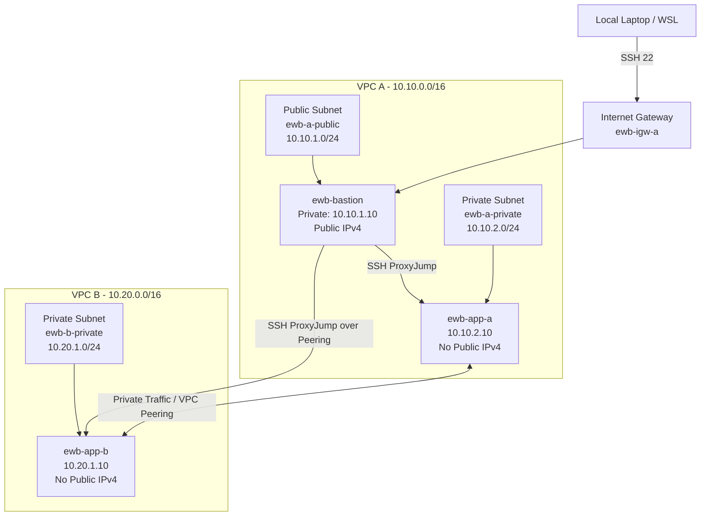

# AWS VPC Peering with Bastion Host

A hands-on AWS networking project demonstrating secure private communication between workloads hosted in two separate VPCs using **VPC Peering, custom route tables, security groups, Amazon EC2, and a bastion host**.

## Project Overview

The objective of this project is to connect two non-overlapping AWS VPCs so that two private EC2 application servers can communicate using their private IPv4 addresses.

A public bastion host in VPC A is used as the administrative entry point. App-A and App-B remain private and do not have public IPv4 addresses.

The project demonstrates:

- Custom VPC and subnet creation
- Public and private subnet architecture
- Internet Gateway configuration
- Custom route tables
- Security groups with least-privilege rules
- Bastion host SSH access
- SSH ProxyJump
- VPC Peering
- Bidirectional private routing
- Connectivity validation
- Controlled security-group failure and recovery

---

## AWS Region

```text
Asia Pacific (Sydney)
ap-southeast-2
```

All project resources were created in the same AWS account and Region.

---

## Architecture



The bastion provides the administrative path. Application traffic between App-A and App-B travels directly across the VPC peering connection using private IPv4 addresses.

VPC B does not receive internet access through VPC A.

---

## Resource Inventory

| Resource | Name | ID / Address |
|---|---|---|
| VPC A | `ewb-vpc-a` | `vpc-02364be552b241cc3` |
| VPC A CIDR | — | `10.10.0.0/16` |
| Public Subnet A | `ewb-a-public` | `subnet-0e538871c92823fac` |
| Public Subnet CIDR | — | `10.10.1.0/24` |
| Private Subnet A | `ewb-a-private` | `subnet-0379bbaa2849fbce9` |
| Private Subnet A CIDR | — | `10.10.2.0/24` |
| VPC B | `ewb-vpc-b` | `vpc-00b24dcb6814622c6` |
| VPC B CIDR | — | `10.20.0.0/16` |
| Private Subnet B | `ewb-b-private` | `subnet-06fbb9e462d365069` |
| Private Subnet B CIDR | — | `10.20.1.0/24` |
| Internet Gateway | `ewb-igw-a` | `igw-0b518bcc91e3dcb59` |
| VPC Peering | `ewb-a-b-peer` | `pcx-033fa7491110d439d` |

---

## EC2 Instances

| Instance | Instance ID | Private IP | Public IP |
|---|---|---|---|
| `ewb-bastion` | `i-036d813be0acc1667` | `10.10.1.10` | Public IPv4 enabled |
| `ewb-app-a` | `i-0b55f898de46d52eb` | `10.10.2.10` | None |
| `ewb-app-b` | `i-0d56614df7b7d44d6` | `10.20.1.10` | None |

The two application instances remain private and are administered through the bastion host.

---

## Route Tables

### VPC A Public Route Table

Route table:

```text
ewb-rt-a-public
rtb-0ebcaea2c3d5ffea2
```

Associated subnet:

```text
ewb-a-public
```

Routes:

| Destination | Target | Purpose |
|---|---|---|
| `10.10.0.0/16` | Local | VPC A communication |
| `0.0.0.0/0` | `ewb-igw-a` | Bastion internet access |
| `10.20.0.0/16` | `ewb-a-b-peer` | Bastion access to VPC B |

### VPC A Private Route Table

```text
ewb-rt-a-private
rtb-0c685736317509ef7
```

Associated subnet:

```text
ewb-a-private
```

Routes:

| Destination | Target |
|---|---|
| `10.10.0.0/16` | Local |
| `10.20.0.0/16` | `ewb-a-b-peer` |

### VPC B Private Route Table

```text
ewb-rt-b-private
rtb-04ace2774ed016e98
```

Associated subnet:

```text
ewb-b-private
```

Routes:

| Destination | Target |
|---|---|
| `10.20.0.0/16` | Local |
| `10.10.0.0/16` | `ewb-a-b-peer` |

Both forward and return routes are required for successful private communication.

---

## Security Groups

### Bastion Security Group

```text
ewb-sg-bastion
sg-00a59f8ec63dde6f8
```

Inbound:

```text
SSH / TCP 22
Source: Current administrator public IPv4 /32
```

### App-A Security Group

```text
ewb-sg-app-a
sg-0e58c823e2bd7fb73
```

Inbound:

```text
SSH / TCP 22
Source: 10.10.1.10/32
```

```text
ICMP Echo Request
Source: 10.20.1.10/32
```

### App-B Security Group

```text
ewb-sg-app-b
sg-0edfa69ccc92ceb32
```

Inbound:

```text
SSH / TCP 22
Source: 10.10.1.10/32
```

```text
ICMP Echo Request
Source: 10.10.2.10/32
```

The rules use `/32` sources to limit access to the individual lab hosts.

---

## SSH Administration

The private key remains on the local machine and is never copied to the EC2 instances.

Example local SSH configuration:

```text
Host ewb-bastion
    HostName BASTION_PUBLIC_IP
    User ec2-user
    IdentityFile ~/.ssh/ewb-lab.pem
    IdentitiesOnly yes

Host ewb-app-a
    HostName 10.10.2.10
    User ec2-user
    IdentityFile ~/.ssh/ewb-lab.pem
    IdentitiesOnly yes
    ProxyJump ewb-bastion

Host ewb-app-b
    HostName 10.20.1.10
    User ec2-user
    IdentityFile ~/.ssh/ewb-lab.pem
    IdentitiesOnly yes
    ProxyJump ewb-bastion
```

Private instances can then be accessed using:

```bash
ssh ewb-app-a
```

and:

```bash
ssh ewb-app-b
```

---

## Verification

### 1. Baseline Test Before Peering

From App-A:

```bash
ping -c 4 10.20.1.10
```

Result:

```text
0 replies
100% packet loss
```

This demonstrated that separate VPCs cannot communicate automatically.

---

### 2. Forward Path After Peering

From App-A:

```bash
ping -c 4 10.20.1.10
```

Result:

```text
4 packets transmitted
4 received
0% packet loss
```

This proves successful connectivity from VPC A to VPC B.

---

### 3. Reverse Path

From App-B:

```bash
ping -c 4 10.10.2.10
```

Result:

```text
4 packets transmitted
4 received
0% packet loss
```

This confirms the return route from VPC B to VPC A.

---

### 4. Private SSH Through Bastion

From the local WSL environment:

```bash
ssh ewb-app-b
```

The session successfully reaches:

```text
10.20.1.10
```

through the bastion host using ProxyJump.

---

## Controlled Failure Test

To prove that the security group controls connectivity, the following App-B rule was temporarily removed:

```text
Custom ICMP - IPv4
Echo Request
Source: 10.10.2.10/32
```

The forward ping from App-A was repeated:

```bash
ping -c 4 10.20.1.10
```

Result:

```text
4 packets transmitted
0 received
100% packet loss
```

After restoring the same ICMP rule, the test was repeated.

Result:

```text
4 packets transmitted
4 received
0% packet loss
```

This demonstrates that an Active VPC peering connection alone does not guarantee connectivity. Routing and security rules must also allow the traffic.

---

## Screenshots

Project evidence is stored in:

```text
/screenshots
```

Evidence includes:

- VPC and subnet configuration
- Internet Gateway
- Route tables and subnet associations
- Security groups
- EC2 instance networking
- Baseline connectivity failure
- Active VPC peering connection
- Forward ping success
- Reverse ping success
- SSH through bastion
- Controlled ICMP failure
- Connectivity recovery

---

## Key Learning Outcomes

This project demonstrated that:

- VPC peering requires non-overlapping VPC CIDRs.
- Peering does not automatically create routes.
- Both forward and return routes are required.
- Security groups still control traffic after peering becomes Active.
- A bastion host provides controlled administrative access to private instances.
- SSH ProxyJump avoids copying private keys onto servers.
- Private EC2 instances do not need public IPv4 addresses for VPC-to-VPC communication.
- VPC peering does not provide transitive routing or internet access through another VPC's Internet Gateway.

---

## Security Notes

The following sensitive files must never be committed to this repository:

```text
*.pem
*.key
.env
credentials
```

AWS passwords, secret keys, access tokens and private SSH keys are intentionally excluded.

---

## Cleanup

After all screenshots and project evidence are saved:

1. Terminate the three project EC2 instances.
2. Remove the VPC peering routes.
3. Delete the VPC peering connection.
4. Delete project security groups.
5. Delete custom route tables and subnets.
6. Detach and delete the Internet Gateway.
7. Delete both project VPCs.
8. Delete the unused lab key pair.
9. Verify that no chargeable project resources remain.

---

## Project Status

```text
VPC Architecture        : Completed
Security Configuration  : Completed
EC2 Deployment          : Completed
Bastion SSH              : Completed
VPC Peering              : Completed
Forward Ping             : Passed
Reverse Ping             : Passed
Private SSH App-B        : Passed
Controlled Failure       : Passed
Recovery Test            : Passed
```

**Project Result: Successfully Completed**