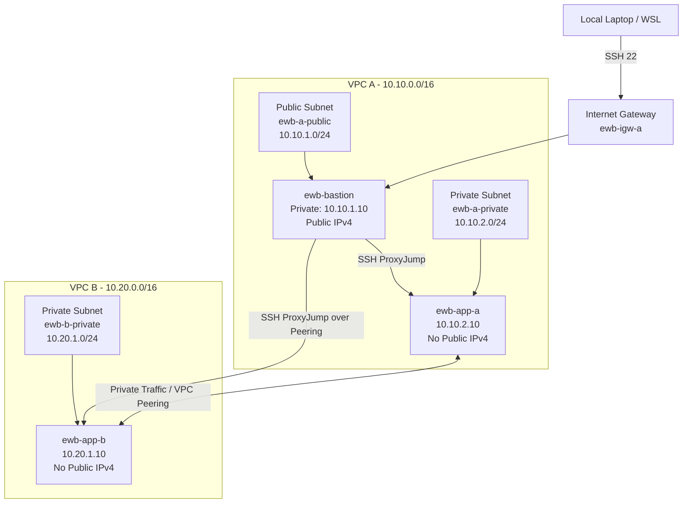

# AWS VPC Peering with Bastion Host

A hands-on AWS networking project demonstrating secure private communication between workloads hosted in two separate VPCs using **VPC Peering, custom route tables, security groups, Amazon EC2, and a bastion host**.

---

## Project Information

**Project:** AWS VPC Peering with Bastion Host  
**Region:** Asia Pacific (Sydney) — `ap-southeast-2`  
**Status:** Completed  
**Completion Date:** October 2026  

---

## Project Overview

The objective of this project is to connect two non-overlapping AWS VPCs so that two private EC2 application servers can communicate using their **private IPv4 addresses**.

A public bastion host in VPC A is used as the administrative entry point. App-A and App-B remain private and do not have public IPv4 addresses.

This project demonstrates:

- Custom VPC and subnet creation
- Public and private subnet architecture
- Internet Gateway configuration
- Custom route tables
- Security groups with restricted inbound rules
- Bastion host SSH access
- SSH ProxyJump
- VPC Peering
- Bidirectional private routing
- Connectivity validation
- Controlled security-group failure and recovery

---

## Architecture



The bastion provides the administrative path. Application traffic between App-A and App-B travels directly across the VPC peering connection using private IPv4 addresses.

VPC B does not receive internet access through VPC A.

If you also created an architecture image, place it here:

```md

```

---

## Resource Inventory

| Resource | Name | ID / Address |
|---|---|---|
| VPC A | `ewb-vpc-a` | `vpc-02364be552b241cc3` |
| VPC A CIDR | — | `10.10.0.0/16` |
| Public Subnet A | `ewb-a-public` | `subnet-0e538871c92823fac` |
| Public Subnet CIDR | — | `10.10.1.0/24` |
| Private Subnet A | `ewb-a-private` | `subnet-0379bbaa2849fbce9` |
| Private Subnet A CIDR | — | `10.10.2.0/24` |
| VPC B | `ewb-vpc-b` | `vpc-00b24dcb6814622c6` |
| VPC B CIDR | — | `10.20.0.0/16` |
| Private Subnet B | `ewb-b-private` | `subnet-06fbb9e462d365069` |
| Private Subnet B CIDR | — | `10.20.1.0/24` |
| Internet Gateway | `ewb-igw-a` | `igw-0b518bcc91e3dcb59` |
| VPC Peering | `ewb-a-b-peer` | `pcx-033fa7491110d439d` |

---

## EC2 Instances

| Instance | Instance ID | Private IP | Public IP |
|---|---|---|---|
| `ewb-bastion` | `i-036d813be0acc1667` | `10.10.1.10` | Enabled |
| `ewb-app-a` | `i-0b55f898de46d52eb` | `10.10.2.10` | None |
| `ewb-app-b` | `i-0d56614df7b7d44d6` | `10.20.1.10` | None |

The two application instances remain private and are administered through the bastion host.

---

## Network Design

### VPC A

```text
CIDR: 10.10.0.0/16
```

Subnets:

```text
ewb-a-public   10.10.1.0/24
ewb-a-private  10.10.2.0/24
```

VPC A contains:

- Internet Gateway
- Public bastion host
- Private App-A instance
- Public route table
- Private route table

### VPC B

```text
CIDR: 10.20.0.0/16
```

Subnet:

```text
ewb-b-private  10.20.1.0/24
```

VPC B contains:

- Private App-B instance
- Private route table
- No Internet Gateway

---

## Route Tables

### VPC A Public Route Table

```text
Name: ewb-rt-a-public
ID:   rtb-0ebcaea2c3d5ffea2
```

Associated subnet:

```text
ewb-a-public
```

| Destination | Target | Purpose |
|---|---|---|
| `10.10.0.0/16` | Local | VPC A internal communication |
| `0.0.0.0/0` | `ewb-igw-a` | Bastion internet access |
| `10.20.0.0/16` | `ewb-a-b-peer` | Bastion access to VPC B |

### VPC A Private Route Table

```text
Name: ewb-rt-a-private
ID:   rtb-0c685736317509ef7
```

Associated subnet:

```text
ewb-a-private
```

| Destination | Target |
|---|---|
| `10.10.0.0/16` | Local |
| `10.20.0.0/16` | `ewb-a-b-peer` |

### VPC B Private Route Table

```text
Name: ewb-rt-b-private
ID:   rtb-04ace2774ed016e98
```

Associated subnet:

```text
ewb-b-private
```

| Destination | Target |
|---|---|
| `10.20.0.0/16` | Local |
| `10.10.0.0/16` | `ewb-a-b-peer` |

Both forward and return routes are required for successful private communication.

---

## Security Groups

### Bastion Security Group

```text
Name: ewb-sg-bastion
ID:   sg-00a59f8ec63dde6f8
```

Inbound rule:

```text
SSH / TCP 22
Source: Current administrator public IPv4 /32
```

### App-A Security Group

```text
Name: ewb-sg-app-a
ID:   sg-0e58c823e2bd7fb73
```

Inbound rules:

```text
SSH / TCP 22
Source: 10.10.1.10/32
```

```text
Custom ICMP - IPv4
Echo Request
Source: 10.20.1.10/32
```

### App-B Security Group

```text
Name: ewb-sg-app-b
ID:   sg-0edfa69ccc92ceb32
```

Inbound rules:

```text
SSH / TCP 22
Source: 10.10.1.10/32
```

```text
Custom ICMP - IPv4
Echo Request
Source: 10.10.2.10/32
```

The `/32` rules restrict access to specific lab hosts instead of exposing access broadly.

---

## SSH Administration

The private SSH key remains only on the local machine and is never copied to the EC2 instances.

Example local SSH configuration:

```text
Host ewb-bastion
    HostName BASTION_PUBLIC_IP
    User ec2-user
    IdentityFile ~/.ssh/ewb-lab.pem
    IdentitiesOnly yes

Host ewb-app-a
    HostName 10.10.2.10
    User ec2-user
    IdentityFile ~/.ssh/ewb-lab.pem
    IdentitiesOnly yes
    ProxyJump ewb-bastion

Host ewb-app-b
    HostName 10.20.1.10
    User ec2-user
    IdentityFile ~/.ssh/ewb-lab.pem
    IdentitiesOnly yes
    ProxyJump ewb-bastion
```

Connect to App-A:

```bash
ssh ewb-app-a
```

Connect to App-B:

```bash
ssh ewb-app-b
```

---

## Verification and Test Results

### 1. Baseline Test Before Peering

From App-A:

```bash
ping -c 4 10.20.1.10
```

Expected and observed result:

```text
0 replies
100% packet loss
```

This proves that separate VPCs do not communicate automatically before peering and route configuration.

Add screenshot:

```md

```

---

### 2. Active VPC Peering

The peering connection:

```text
ewb-a-b-peer
pcx-033fa7491110d439d
```

Status:

```text
Active
```

Add screenshot:

```md

```

---

### 3. Forward Path Test

From App-A:

```bash
ping -c 4 10.20.1.10
```

Result:

```text
4 packets transmitted
4 received
0% packet loss
```

This proves successful communication from VPC A to VPC B.

Add screenshot:

```md

```

---

### 4. Reverse Path Test

From App-B:

```bash
ping -c 4 10.10.2.10
```

Result:

```text
4 packets transmitted
4 received
0% packet loss
```

This confirms the return path from VPC B to VPC A.

Add screenshot:

```md

```

---

### 5. Private SSH Through Bastion

From local WSL:

```bash
ssh ewb-app-b
```

The session successfully reaches:

```text
10.20.1.10
```

through the bastion host using ProxyJump.

Add screenshot:

```md

```

---

## Controlled Failure and Recovery

To prove that the security group controls connectivity, this App-B inbound rule was temporarily removed:

```text
Custom ICMP - IPv4
Echo Request
Source: 10.10.2.10/32
```

Then the forward ping from App-A was repeated:

```bash
ping -c 4 10.20.1.10
```

Result:

```text
4 packets transmitted
0 received
100% packet loss
```

Add screenshot:

```md

```

After restoring the ICMP rule, the test was repeated.

Result:

```text
4 packets transmitted
4 received
0% packet loss
```

Add screenshot:

```md

```

This demonstrates that an **Active** VPC peering connection alone does not guarantee connectivity. Route tables and security groups must also allow the traffic.

---

## Forward Path Explanation

The forward path from App-A to App-B is:

```text
App-A
10.10.2.10
   |
   v
ewb-rt-a-private
10.20.0.0/16 -> VPC Peering
   |
   v
ewb-a-b-peer
   |
   v
VPC B
   |
   v
ewb-b-private
   |
   v
App-B
10.20.1.10
```

The App-B security group must allow ICMP Echo Request from:

```text
10.10.2.10/32
```

---

## Return Path Explanation

The return path from App-B to App-A is:

```text
App-B
10.20.1.10
   |
   v
ewb-rt-b-private
10.10.0.0/16 -> VPC Peering
   |
   v
ewb-a-b-peer
   |
   v
VPC A
   |
   v
ewb-a-private
   |
   v
App-A
10.10.2.10
```

Without this return route, bidirectional communication would fail.

---

## Project Evidence

All screenshots are stored in:

```text
/screenshots
```

Suggested evidence files:

```text
01-vpc-a.png
02-vpc-a-subnets.png
03-internet-gateway.png
04-vpc-a-public-route-table.png
05-vpc-a-private-route-table.png
06-vpc-b.png
07-vpc-b-private-subnet.png
08-vpc-b-private-route-table.png
09-security-group-bastion.png
10-security-group-app-a.png
11-security-group-app-b.png
12-ec2-instances.png
13-baseline-before-peering.png
14-peering-active.png
15-route-a-private-peering.png
16-route-b-private-peering.png
17-route-a-public-peering.png
18-forward-ping-success.png
19-reverse-ping-success.png
20-private-ssh-app-b.png
21-controlled-failure.png
22-controlled-recovery.png
23-cleanup-evidence.png
```

---

## Key Learning Outcomes

This project demonstrated that:

- VPC peering requires non-overlapping CIDR blocks.
- Peering does not automatically create routes.
- Both forward and return routes are required.
- Security groups continue to control traffic after peering becomes Active.
- A bastion host provides controlled administrative access to private instances.
- SSH ProxyJump avoids copying private keys onto remote servers.
- Private EC2 instances can communicate across VPCs without public IPv4 addresses.
- VPC peering is non-transitive.
- VPC B cannot use VPC A's Internet Gateway through the peering connection.
- An Active peering connection alone does not guarantee successful communication.

---

## Security Notes

Sensitive files must never be committed to GitHub.

Recommended `.gitignore` entries:

```gitignore
*.pem